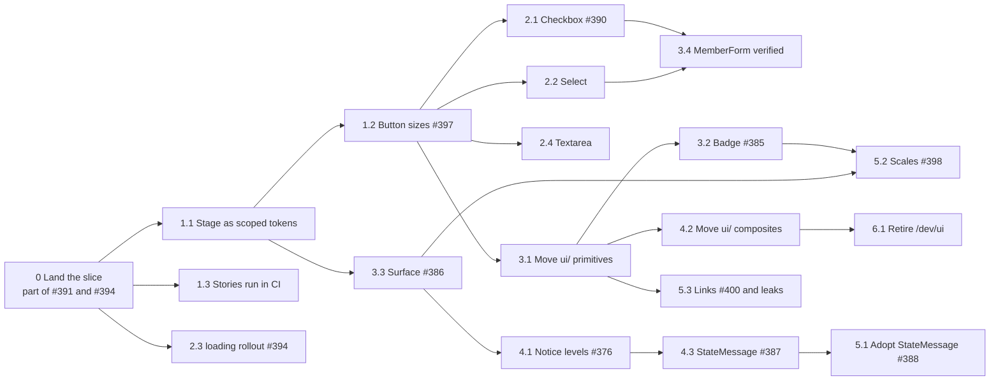

# 04 · Roadmap (Phase 6)

> What to build next, in what order, and roughly how long each step takes. Written at the end of the learning session, after the vertical slice (Button, Input, FormField, Contact) and Checkpoint 2.
> Counts were measured on branch `ccr-dec058aa-1fvzz2` on 2026-11-12 with `rg` over `web/src`, tests, mocks and generated code excluded. Re-count before starting a step; the app keeps moving.

## 0. Decisions this roadmap rests on

Answered at Checkpoint 2:

1. The roadmap maps onto the UI/UX Improvements milestone (#385 to #401) instead of duplicating it. New issues are only *proposed* here (§6); none was created.
2. The design system stays an in-app module. Moving it to a workspace package comes later, as an optional exercise (step 7.3).
3. Contact remains the slice's migrated screen. MemberForm is the first real migration, as soon as Select and Checkbox exist (step 3.4).
4. Button's `loading` state goes to every other form as a roadmap step (2.3, under #394), not on the slice branch.

## 1. How to read the estimates

- One unit is a focused working day of one developer working with Claude Code sessions, from branch to merged PR, including what every PR here needs anyway: screenshots at 375 and 1280 px in FR and DE, the PR body, and CI.
- The basis for each number is in the row: call sites to change, the review's effort label (`effort:s/m/l`), and what the slice itself cost for something similar.
- Read the numbers as ±50 %. The slice showed where the error comes from. The code was quick. Making a guard *actually fail* took longest (`eslint-plugin-boundaries` silently checked nothing at first), and so did proving "no visual change" (the font-path trap in the pixel diff).
- Total for steps 0 to 6: about 22 days, of which about 6 are adoption, meaning call sites moved onto components that already exist. Step 7 is optional and not counted.

## 2. Definition of done for a design-system step

The same checklist for every component, so no step has to argue it again (ADR 0003, ADR 0005):

1. It lives in `web/src/design-system/<layer>/<name>/`, is exported from the `@ds` barrel, and imports no `@/` path (`lint:boundaries` proves it).
2. Every variant and state has a story that renders with no providers (ADR 0004).
3. Unit tests cover role, name, `ref`, `className` merging and every state, and `expectNoA11yViolations` runs per state.
4. Every call site moves in the same PR. A half-adopted component only adds one more way of doing the thing. If the PR grows past roughly 400 lines, split it by screen, not by "component first, adoption later".
5. A guard fails if the old pattern comes back (a raw `<select>`, a hand-rolled pill), and the PR shows it failing once (mutation test).
6. A pixel diff against `main` at 375 and 1280 px shows only the intended changes, listed in the PR.

This is the [strangler fig](https://martinfowler.com/bliki/StranglerFigApplication.html) pattern applied to a component layer: the new layer grows around the old code one call site at a time, and each step leaves the app shippable.

## 3. The order

### Step 0: Land the slice

| # | Step | Issue | Estimate | Basis |
| --- | --- | --- | --- | --- |
| 0 | Open the PR from `ccr-dec058aa-1fvzz2`: Button, Input, FormField, tokens, Storybook, boundaries, Contact `loading` | Part of #391 and #394 (not `Closes`) | 0.5 | The code is green. What is left is the PR body with the pixel diff, and review. |

Nothing below starts before this merges. Every later step builds on `@ds`, and a long-lived branch under 75 rewritten imports will conflict with every other PR.

Why "part of" #391: its acceptance criteria also cover selects, textareas, switches and links. The slice fixed Button and Input. #391 closes with the last of 2.2, 2.4 and 3.1.

### Step 1: Fix the template before it gets copied

Button is the component every new primitive will be modelled on. Its two known flaws get cheaper to fix the fewer copies exist, so they go first. The review's tracker (#401) puts #397 late, in its "consolidation" group. I move it forward for that reason.

| # | Step | Issue | Estimate | Basis |
| --- | --- | --- | --- | --- |
| 1.1 | Replace Button's `surface="page\|stage"` prop and its two compound variants with a scoped override: `[data-surface="stage"] { --color-focus: …; --raised-color: var(--color-pink); }`. Split the shadow tokens into offset and `--raised-color`. | new (N3) | 1 | 5 `surface="stage"` call sites. The shadow split touches `styles.css` and every `shadow-raised*` user (about 10). Surface (3.3) needs the same split, so it also unblocks that. |
| 1.2 | One `(height, padding-x, font-size)` triple per size: `sm` 44, `md` 44, `lg` 48. Delete the dead `h-6/8/9/10` (`min-h-touch` beats `height`). Hero and form submits use `lg`. | #397 | 0.5 | 31 `size="sm"` call sites keep their name. 1 per-call `px-*` override to remove. |
| 1.3 | Run the stories' `play` functions and the a11y addon in CI (`@storybook/addon-vitest`, in the existing `assets` job so `all-green` is untouched). Today stories only build. | new (N4) | 1 | Needs Vitest browser mode with Playwright in CI. The container's Chromium path trap (HANDOVER §8) applies. Least certain number on this page. |

### Step 2: The form primitives

| # | Step | Issue | Estimate | Basis |
| --- | --- | --- | --- | --- |
| 2.1 | `Checkbox` primitive: a native `<input type="checkbox">`, fixed 20×20 px box with `shrink-0`, aligned to the first label line, the whole label row ≥ 44 px. Guard: no raw `type="checkbox"` outside `@ds`. | #390 | 1 | 8 raw checkboxes in 6 files (`MemberForm` 2, `SeriesForm` 2, `EventForm`, `HistoryForm`, `Roles`, `LibraryGrid`). |
| 2.2 | `Select` primitive: a native `<select>` with the Input's tokens and focus ring, and a chevron inside. Guard: no raw `<select>` outside `@ds`. | new (N1) | 1 | 11 raw selects in 7 files; 6 of them share one hand-copied class string (01-current-state §4). |
| 2.3 | `loading` on every submit that waits for the network, replacing `aria-disabled={busy}` / `{x.isPending}`. | #394 | 1 | About 20 form submits in 15 files (Login, EventBooking, AccountPassword, MemberForm, EventForm ×3, HistoryForm, Registers ×2, Roles ×2, EventTags ×2, MediaDetail, EventRegistrations, BlockEditor, EventFormEditor, MemberBooking ×2). Dialog confirm buttons (about 15 more) only where they wait on the network. |
| 2.4 | `Textarea` primitive. The DS `FormField` and the app adapter stop hand-writing one "kept in step by hand" with Input. | new (N2) | 0.5 | 1 textarea in the DS composite, 1 in the adapter. Small, so it can share a PR with 2.2. |

Why native elements and not Radix `Checkbox`/`Select`: `react-hook-form`'s `register` works with native elements as they are, phones get their own picker, and the a11y semantics come free. A Radix select is a custom listbox with its own keyboard model. That is worth it only for things a native select cannot do (search, rich options), and nothing in the app needs those today.

### Step 3: Move what exists, then the display primitives

| # | Step | Issue | Estimate | Basis |
| --- | --- | --- | --- | --- |
| 3.1 | Move the remaining vendored primitives from `components/ui/` into `@ds/primitives`: `IconButton`, `Switch`, `RadioGroup`, `Indicator`. Each gets stories and axe tests, and the focus ring of #391. | new (N5) | 1 | 17 + 5 + 4 + 3 importers, all mechanical rewrites. Tests already exist for 3 of the 4. |
| 3.2 | `Badge` primitive (`tone`, `size`, `tint` for tags), replacing the hand-rolled pills, `TagChip` and `SuspectFlag`. `Indicator` stays separate (a count, not a label). | #385 | 1.5 | 9 hand-rolled `rounded-full … text-xs` strings in 6 files, plus `TagChip` and `LoginState`. The contrast check per tint must run in Playwright (no contrast in jsdom, ADR 0005). |
| 3.3 | `Surface` primitive (`list`, `feature`, `form`, `placeholder`), one radius token. Decide 18 vs 20 px first (look at both on the home tiles; the review counts 18 as the common one). `Card` is deleted at the end. Two PRs: lists, then tiles and form panels. | #386 | 2.5 | `Card` has 8 importers. Arbitrary radii in 10 places across 8 files. The review counts 47 surface signatures. `effort:l`. |
| 3.4 | Verify MemberForm as the second migrated screen: no raw control left, pixel diff and axe at 375/1280 FR/DE, like Contact was. | (closes nothing; evidence for 2.1 and 2.2) | 0.5 | After 2.1 and 2.2 the code is already migrated. This step is the proof, the same one the slice gave for Contact. |

### Step 4: Composites

| # | Step | Issue | Estimate | Basis |
| --- | --- | --- | --- | --- |
| 4.1 | Move `Notice` into `@ds/composites` while giving it the toast's four levels. | #376 (R11 milestone) | 0.5 | #376 is planned in the WYSIWYG track. Doing it inside the DS lands it once instead of twice. Coordinate with whoever picks up #376. |
| 4.2 | Move `Dialog`, `AlertDialog`, `DropdownMenu`, `FormActions` and the toast card. The toast's `t("common.close")` becomes a `closeLabel` prop; `notify()` stays the app adapter that supplies it. | new (N6) | 1.5 | 3 + 13 + 5 + 18 + 4 importers. The toast is the only `ui/` file that imports i18n (01-current-state §3). |
| 4.3 | `StateMessage` (`loading`, `empty`, `error`, with Réessayer). The three `text-red-700` and the `text-gray-600` become `--color-feedback-*`. | #387 | 1.5 | Builds on Button, Notice (4.1), optionally Surface. Strings come in as props; the app's `retry` wiring stays outside the DS. |

### Step 5: Adoption and consolidation

| # | Step | Issue | Estimate | Basis |
| --- | --- | --- | --- | --- |
| 5.1 | Adopt `StateMessage` on every list screen, after forcing slow, empty and failing responses on each and recording what it does today. | #388 | 2.5 | 10 screens named in the issue; 20 pages handle `isError` somehow. Two PRs (members' lists, then the editors). |
| 5.2 | Write the radius, shadow, type, z-index and motion scales into `tokens.css` and add a scan under `tools/` that fails on a value outside them. | #398 | 2 | Blocked by #385 and #386, whose variants decide the radius and shadow sets. 8 arbitrary type sizes, 3 `z-[35]`, 2 stray beziers (01-current-state §1.2). |
| 5.3 | `TextLink` primitive with a `standalone` variant (44 px target on touch) via `asChild`, so the app's locale-aware `Link` stays in the app. Retire `ButtonLink` for `Button asChild` in the same PR. | #400 + part of N6 | 1 | `ButtonLink` has 10 importers. Back links appear on 3 screens. |

### Step 6: Cleanup

| # | Step | Issue | Estimate | Basis |
| --- | --- | --- | --- | --- |
| 6.1 | Retire `/dev/ui` once stories cover every section of it. Remove its route and its `pages.json` entry. | part of N6 | 0.5 | ADR 0004 keeps it only until then. The screenshot sweep loses one page and nothing else. |

### Step 7: Later, and only with a reason

| # | Step | Trigger | Estimate |
| --- | --- | --- | --- |
| 7.1 | `@ds/brand` entry: `Scallop`, `Confetti`, `PageHero`. Invert `Highlighted` so the app parses `markTokens` and passes nodes. Move the `social.tsx` icon map to the app. | The first time a DS layer wants decoration, or #396 shows confetti in the visitor bundle. | 1.5 |
| 7.2 | Visual regression in CI (Playwright screenshots of stories, Linux baselines generated in CI only). | When a pixel change slips through review once. ADR 0005 explains why not before. | 1.5 |
| 7.3 | Promote `design-system/` to a source-only workspace package (`packages/ui`, `exports`, `peerDependencies`, an `@source` line). | When you want to feel package boundaries as an exercise. The lint rules already guarantee no `@/` imports, which was the expensive part. | 1 |
| 7.4 | DTCG tokens with Style Dictionary, and typed token names generated from `tokens.css`. | A second consumer of the values: Figma variables, an e-mail template, or the ADR mock-ups that copy colours by hand. | 2 |

## 4. Issues that are not design-system work

They run in parallel with everything above and need nothing from it:

| Issue | Why it is app work |
| --- | --- |
| #389 page titles and route announcements | A hook next to the route table. Do it with #399, which changes the same titles. |
| #392 heading levels | Markup in pages. The DS has no heading component, on purpose: the level depends on where a heading sits. |
| #393 editor hints shown to visitors | Permission and edit-mode logic, so app layer. |
| #395 home hero shift | Font loading in `styles.css` and `index.html`. |
| #396 bundle and LCP | Route splitting. One check belongs to the DS, though: confirm the `@ds` barrel does not pull Radix dialogs into the visitor entry. Rollup should tree-shake an ESM barrel, but nobody has measured it here. |
| #399 one name for "Planning" | Catalogue copy in `fr.ts` and `de.ts`. |

## 5. Mapping to the review's issues

| Issue | Roadmap step | DS work? |
| --- | --- | --- |
| #385 Badge | 3.2 | yes |
| #386 Surface | 3.3 | yes |
| #387 StateMessage | 4.3 | yes |
| #388 adopt StateMessage | 5.1 | yes (adoption) |
| #389 page titles | §4 | no |
| #390 checkbox shrink | 2.1 | yes, the fix *is* the primitive |
| #391 focus indicator | 0, then 2.2, 2.4 and 3.1 | yes, partly done in the slice |
| #392 heading levels | §4 | no |
| #393 editor hints | §4 | no |
| #394 sending state | 0 (Contact), 2.3 (the rest) | yes, Button `loading` |
| #395 hero shift | §4 | no |
| #396 bundle | §4 | no, one check |
| #397 button sizes | 1.2 | yes |
| #398 scales | 5.2 | yes |
| #399 "Planning" | §4 | no |
| #400 link targets | 5.3 | yes |
| #401 tracker | covered by this table | n/a |
| #376 Notice levels (R11) | 4.1 | yes, done inside the DS |

## 6. Proposed new issues (not created)

Only for gaps the review did not see, because it was black-box and these live in the code. Draft titles, in the milestone's style:

| Id | Title | Why it is a gap |
| --- | --- | --- |
| N1 | Add a Select primitive and replace the 11 hand-written selects | Not visible from outside: the selects look alike, but one class string is copied 6 times by hand. |
| N2 | Add a Textarea primitive so FormField stops hand-copying the Input's look | The adapter's own comment says it is kept in step by hand. |
| N3 | Scope the stage colours with `data-surface` instead of Button's `surface` prop | An architecture fix (02-architecture §5). Not a defect anyone can see. |
| N4 | Run Storybook play functions and a11y checks in CI | Stories only build today, so a broken state renders nowhere. |
| N5 | Move IconButton, Switch, RadioGroup and Indicator into the design system | Until it is done, components have two homes and only half of them are bound by the boundary rules. |
| N6 | Move the vendored composites into the design system and close its last i18n and router leaks | Toast `closeLabel`, `ButtonLink`, retiring `/dev/ui`. |

Each would go into the UI/UX Improvements milestone, with #401's checklist extended.

## 7. What would change this order

- #376 slips in the R11 track. Then build StateMessage on a two-level Notice and add the levels later. 4.3 does not have to wait.
- The 18 vs 20 px decision goes to 20. Then the list cards move too, and 3.3 grows by about half a day.
- 1.3 turns out expensive (browser mode in CI fighting the container). Then drop it to "stories build, a11y runs locally". The unit tests already carry the contract, so dropping it costs convenience while the contract stays tested.
- A second consumer appears (a second band site, an e-mail template). Then 7.3 and 7.4 move up, and versioning comes back (ADR 0006).
